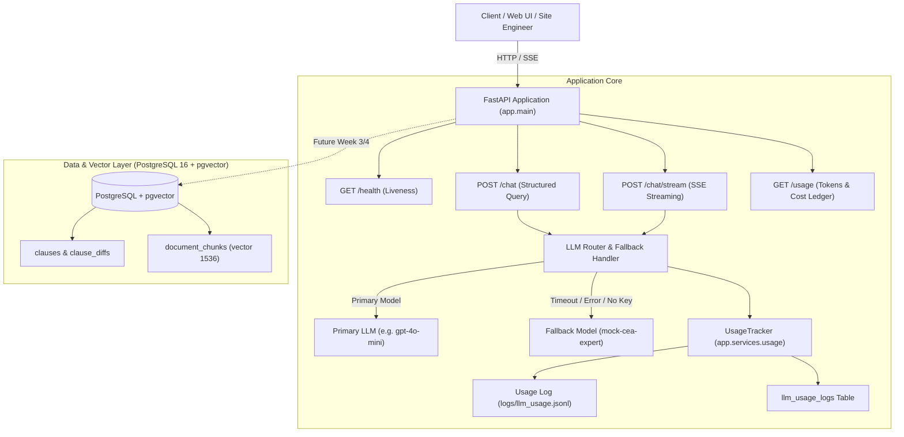
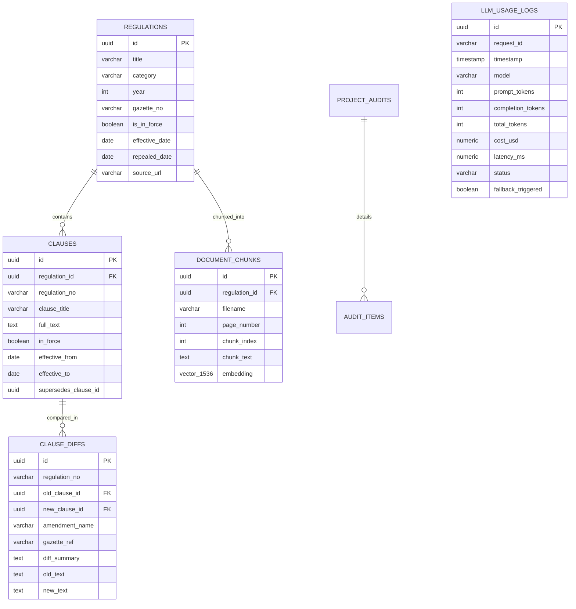
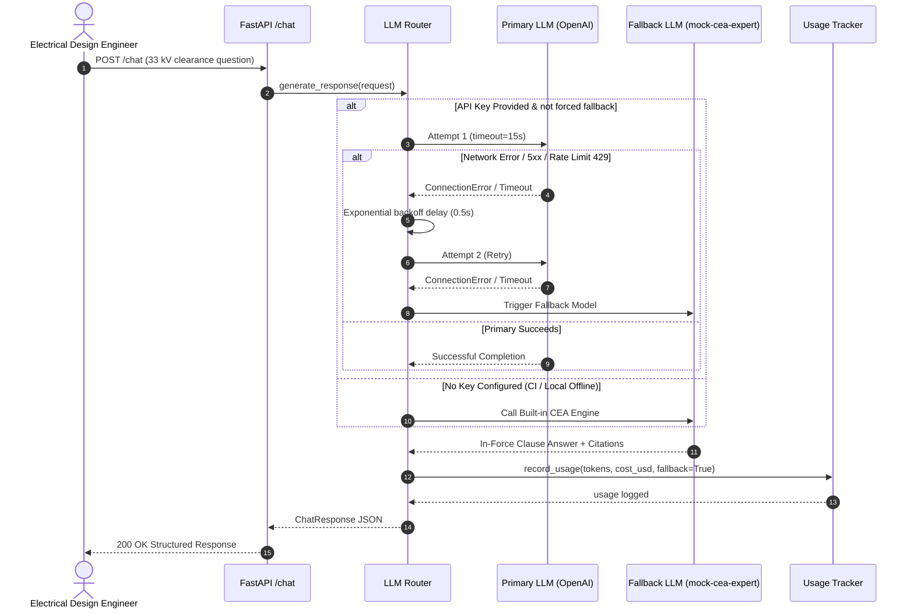

# VoltClause: System Architecture & Design Document (Week 2)

VoltClause provides electrical engineers with the currently valid Central Electricity Authority (CEA) safety and technical clauses, tracks which version is in force, highlights clause-by-clause diffs, and automates substation/solar design compliance checks.

---

## 1. System Overview & Architecture

### Target User & Workflow
- **User**: Electrical design engineer at an EPC firm building rooftop solar and 33/11 kV substations in Tiruppur.
- **Problem**: CEA regulations (Safety, Technical Standards, Grid Connectivity, Metering) are amended frequently. Site teams frequently carry obsolete printouts (e.g. 2010 rules instead of 2023 in-force revisions). Citing a repealed clearance or earthing clause can fail an Electrical Inspectorate inspection or cause electrical accidents.
- **Solution**: A version-aware RAG platform and technical research agent that verifies current in-force clauses, renders diff cards between versions, and tracks all LLM token consumption and costs.

### High-Level Architecture Diagram



---

## 2. API Endpoints Specification

### Currently Implemented (Week 2)

| Method | Endpoint | Description | Auth / Key | Response Type |
|---|---|---|---|---|
| `GET` | `/health` | Rapid liveness probe. Checks process state without external calls. | None | `application/json` |
| `POST` | `/chat` | Queries CEA clauses. Supports primary LLM, retry loop, fallback, and streaming. | Optional API Key | `application/json` / `text/event-stream` |
| `POST` | `/chat/stream` | Dedicated Server-Sent Events (SSE) streaming endpoint emitting token chunks. | Optional API Key | `text/event-stream` |
| `GET` | `/usage` | Returns cumulative prompt/completion tokens, costs in USD, model breakdowns, and recent logs. | None | `application/json` |
| `POST` | `/usage/reset` | Resets in-memory metrics and clears current test logs. | None | `application/json` |

---

### Planned Future Endpoints (Week 3 & Week 4)

| Method | Endpoint | Week | Description |
|---|---|---|---|
| `POST` | `/ask` | Week 3 | RAG semantic question answering returning exact `[document, page]` citations. |
| `GET` | `/clause/{regulation_no}` | Week 3 | Retrieves full text of an active CEA clause and its historical amendments. |
| `GET` | `/clause/diff` | Week 4 | Signature clause diff card: compares old vs new text for any amended regulation. |
| `POST` | `/checklist/generate` | Week 4 | Research agent builds compliance checklists for a 33 kV substation or solar plant. |

---

### Detailed Endpoint Contracts

#### 1. `GET /health`
- **Purpose**: Fast container and load-balancer health verification.
- **Response**:
```json
{
  "status": "ok",
  "app": "VoltClause",
  "environment": "production"
}
```

#### 2. `POST /chat`
- **Request Body**:
```json
{
  "message": "What is the minimum vertical clearance for a 33 kV line over a road?",
  "project_type": "substation",
  "voltage_level_kv": 33.0,
  "stream": false,
  "force_fallback": false,
  "temperature": 0.2
}
```
- **Response (200 OK)**:
```json
{
  "reply": "Under the Central Electricity Authority (Measures relating to Safety and Electric Supply) Regulations, 2023, Regulation 58, the mandatory minimum vertical ground clearance for a 33 kV overhead transmission line across any street or road is 6.1 metres...",
  "model_used": "gpt-4o-mini",
  "provider": "openai",
  "fallback_triggered": false,
  "attempt_count": 1,
  "usage": {
    "prompt_tokens": 128,
    "completion_tokens": 92,
    "total_tokens": 220,
    "cost_usd": 0.000074
  },
  "citations": [
    {
      "document": "Central Electricity Authority (Measures relating to Safety and Electric Supply) Regulations, 2023",
      "regulation_no": "Regulation 58",
      "clause": "Clearance above ground of lowest conductor across street",
      "in_force": true,
      "amendment_ref": "CEA Safety Regulations 2023 (Gazette June 2023)"
    }
  ],
  "metadata": {
    "latency_ms": 142.5,
    "voltage_level_kv": 33.0,
    "project_type": "substation"
  }
}
```

#### 3. `GET /usage`
- **Response (200 OK)**:
```json
{
  "total_requests": 14,
  "total_prompt_tokens": 1820,
  "total_completion_tokens": 1140,
  "total_tokens": 2960,
  "total_cost_usd": 0.000957,
  "breakdown_by_model": {
    "gpt-4o-mini": {
      "requests": 10,
      "prompt_tokens": 1400,
      "completion_tokens": 900,
      "total_tokens": 2300,
      "cost_usd": 0.000750
    },
    "mock-cea-expert": {
      "requests": 4,
      "prompt_tokens": 420,
      "completion_tokens": 240,
      "total_tokens": 660,
      "cost_usd": 0.0
    }
  },
  "recent_logs": [
    {
      "id": "8c3b4fe6-0312-4fbc-b5b7-7e61e680a6b4",
      "timestamp": "2026-10-30T10:14:22.124Z",
      "model": "gpt-4o-mini",
      "prompt_tokens": 128,
      "completion_tokens": 92,
      "total_tokens": 220,
      "cost_usd": 0.000074,
      "latency_ms": 142.5,
      "status": "success",
      "fallback_triggered": false
    }
  ]
}
```

---

## 3. Database Schema & Tables (PostgreSQL 16 + pgvector)



### PostgreSQL DDL Scripts

```sql
-- Enable vector extension for Week 3 RAG
CREATE EXTENSION IF NOT EXISTS "uuid-ossp";
CREATE EXTENSION IF NOT EXISTS vector;

-- 1. Regulations Master
CREATE TABLE regulations (
    id UUID PRIMARY KEY DEFAULT uuid_generate_v4(),
    title VARCHAR(255) NOT NULL,
    short_code VARCHAR(50) NOT NULL,
    category VARCHAR(100) NOT NULL, -- 'safety', 'grid_connectivity', 'construction', 'metering'
    year INTEGER NOT NULL,
    gazette_no VARCHAR(100),
    is_in_force BOOLEAN NOT NULL DEFAULT TRUE,
    effective_date DATE NOT NULL,
    repealed_date DATE,
    source_url TEXT,
    created_at TIMESTAMP WITH TIME ZONE DEFAULT CURRENT_TIMESTAMP
);

-- 2. Clauses Table with Version Tracking
CREATE TABLE clauses (
    id UUID PRIMARY KEY DEFAULT uuid_generate_v4(),
    regulation_id UUID NOT NULL REFERENCES regulations(id) ON DELETE CASCADE,
    regulation_no VARCHAR(50) NOT NULL,   -- e.g. 'Regulation 58'
    clause_title VARCHAR(255) NOT NULL,
    full_text TEXT NOT NULL,
    in_force BOOLEAN NOT NULL DEFAULT TRUE,
    effective_from DATE NOT NULL,
    effective_to DATE,
    supersedes_clause_id UUID REFERENCES clauses(id),
    created_at TIMESTAMP WITH TIME ZONE DEFAULT CURRENT_TIMESTAMP
);
CREATE INDEX idx_clauses_reg_no ON clauses(regulation_no);
CREATE INDEX idx_clauses_in_force ON clauses(in_force);

-- 3. Clause Diffs Table (Signature Feature)
CREATE TABLE clause_diffs (
    id UUID PRIMARY KEY DEFAULT uuid_generate_v4(),
    regulation_no VARCHAR(50) NOT NULL,
    old_clause_id UUID REFERENCES clauses(id),
    new_clause_id UUID REFERENCES clauses(id),
    amendment_name VARCHAR(255) NOT NULL,
    gazette_ref VARCHAR(100),
    diff_summary TEXT NOT NULL,
    old_text TEXT NOT NULL,
    new_text TEXT NOT NULL,
    created_at TIMESTAMP WITH TIME ZONE DEFAULT CURRENT_TIMESTAMP
);

-- 4. Vector Store for Document Chunks
CREATE TABLE document_chunks (
    id UUID PRIMARY KEY DEFAULT uuid_generate_v4(),
    regulation_id UUID REFERENCES regulations(id) ON DELETE CASCADE,
    filename VARCHAR(255) NOT NULL,
    page_number INTEGER NOT NULL,
    chunk_index INTEGER NOT NULL,
    chunk_text TEXT NOT NULL,
    token_count INTEGER NOT NULL,
    embedding vector(1536),
    created_at TIMESTAMP WITH TIME ZONE DEFAULT CURRENT_TIMESTAMP
);
CREATE INDEX idx_chunks_page ON document_chunks(filename, page_number);

-- 5. LLM Usage and Cost Ledger
CREATE TABLE llm_usage_logs (
    id UUID PRIMARY KEY DEFAULT uuid_generate_v4(),
    request_id VARCHAR(64) NOT NULL,
    timestamp TIMESTAMP WITH TIME ZONE NOT NULL,
    model VARCHAR(64) NOT NULL,
    prompt_tokens INTEGER NOT NULL,
    completion_tokens INTEGER NOT NULL,
    total_tokens INTEGER NOT NULL,
    cost_usd NUMERIC(10, 6) NOT NULL,
    latency_ms NUMERIC(10, 2) NOT NULL,
    status VARCHAR(32) NOT NULL,
    fallback_triggered BOOLEAN NOT NULL DEFAULT FALSE
);
CREATE INDEX idx_usage_timestamp ON llm_usage_logs(timestamp);
CREATE INDEX idx_usage_model ON llm_usage_logs(model);
```

---

## 4. LLM Resilience, Retry & Fallback Architecture

To ensure high availability and robust CI execution without paid API secrets, VoltClause implements a multi-tiered fallback strategy:



### Fallback Guarantee
- **CI Safety**: Tests pass automatically in CI without API keys.
- **Field Safety**: If site internet has jitter or external LLMs experience outages, the EPC engineer receives verified, deterministic CEA regulations rather than failing inspections.

---

## 5. Token Pricing & Cost Accounting

Pricing is computed per million tokens:

$$\text{Cost} = \frac{(\text{Prompt Tokens} \times \text{Rate}_{\text{prompt}}) + (\text{Completion Tokens} \times \text{Rate}_{\text{completion}})}{1,000,000}$$

| Model | Prompt Rate / 1M Tokens | Completion Rate / 1M Tokens | Typical Query Cost |
|---|---|---|---|
| `gpt-4o-mini` | $0.15 | $0.60 | ~$0.00007 |
| `gpt-4o` | $2.50 | $10.00 | ~$0.00120 |
| `gpt-3.5-turbo` | $0.50 | $1.50 | ~$0.00025 |
| `gemini-1.5-flash` | $0.075 | $0.30 | ~$0.00004 |
| `gemini-1.5-pro` | $1.25 | $5.00 | ~$0.00060 |
| `mock-cea-expert` | $0.00 | $0.00 | $0.00000 |

Usage logs are queryable in real-time via `GET /usage` for audit and financial tracking.
